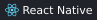

  <picture>
    <source media="(prefers-color-scheme: dark)" srcset="./assets/banner-dark.svg">
    
  </picture>

<h4 align="center">A software engineer, also known as LopMan. Professionally solving problems I accidentally create 👾</h4>

  
  
  

## My expertise

  <picture>
    <source media="(prefers-color-scheme: dark)" srcset="https://skillicons.dev/icons?i=py%2Cpytorch%2Copencv%2Ccpp%2Cc%2Ccs%2Cjava%2Clinux%2Craspberrypi&theme=dark">
    
  </picture>
   
  <picture>
    <source media="(prefers-color-scheme: dark)" srcset="https://skillicons.dev/icons?i=ts%2Cjs%2Creact%2Cnextjs%2Cangular%2Chtml%2Ccss%2Cjquery%2Cphp%2Cmysql%2Cgit%2Cgithub&theme=dark">
    
  </picture>
    
  
  
  
  
  
  
  

